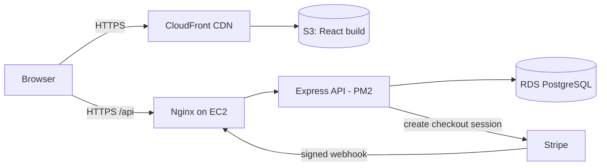

# Full-Stack E-commerce Demo

A deployed e-commerce demo with a React storefront, an Express REST API, a PostgreSQL database and Stripe test-mode checkout, hosted on AWS.

**Live demo:** https://store-demo.pennyhsiao.com
**API health check:** https://api.pennyhsiao.com/api/health

> Portfolio project by Penny Hsiao. Not affiliated with or endorsed by Apple Inc. Product names and images belong to their respective owners. Nothing is for sale: payments run in Stripe test mode only.


## Try it

1. Open the [live demo](https://store-demo.pennyhsiao.com), pick a colour and size, and add it to your bag
2. Check out with Stripe's test card `4242 4242 4242 4242` (any future expiry date, any CVC)
3. You'll land on an order confirmation page that updates to **Paid** once Stripe's webhook arrives
4. Use **Support → Track an order** with your order number and email to look it up later

## Features

- **Storefront:** iPhone and MacBook product pages with 3D models and scroll animations, colour and size selection with live prices from the API
- **Cart:** persistent bag (saved in the browser), quantity changes, subtotal
- **Checkout:** Stripe Checkout (hosted), with prices re-calculated on the server so the browser can't change them
- **Webhooks:** a signed Stripe webhook marks orders as paid, saves the customer email and reduces stock in one database transaction
- **Order lookup:** customers find an order with order number **plus** email
- **Responsive:** mobile menu and layouts for phones and desktops

## Tech stack

| Layer | Tools |
|---|---|
| Frontend | React 19, Vite, Tailwind CSS 4, GSAP, React Three Fiber (Three.js), React Router, Zustand |
| Backend | Node.js, Express 5, `pg`, Stripe Node SDK |
| Database | PostgreSQL (prices stored in cents, AUD) |
| Payments | Stripe Checkout + webhooks (test mode) |
| Hosting | AWS: S3 + CloudFront (frontend), EC2 + Nginx + PM2 + Let's Encrypt (API), RDS PostgreSQL (database) |
| DNS | Vercel DNS |

## Architecture



## API

| Method | Route | What it does |
|---|---|---|
| GET | `/api/health` | Health check |
| GET | `/api/products` | All products with variants |
| GET | `/api/products/:slug` | One product (e.g. `iphone-15-pro`) |
| POST | `/api/checkout` | Validates the cart, creates a pending order and a Stripe Checkout session |
| POST | `/api/webhooks/stripe` | Stripe webhook (`checkout.session.completed`): marks the order paid and updates stock |
| GET | `/api/orders/session/:sessionId` | Order details for the confirmation page |
| GET | `/api/orders/lookup?orderId=&email=` | Order lookup by number and email |

The backend uses a layered structure: **routes → controllers → services → models**.

## Database

Five tables: `users`, `products`, `product_variants` (colour, size, SKU, price, stock), `orders` and `order_items`.
Schema and seed data are in [`database/`](database).

## Project structure

| Folder | What's in it |
|---|---|
| `frontend/` | React storefront (routes: `/iphone`, `/macbook`, `/cart`, `/checkout/success`, `/orders/lookup`) |
| `backend/` | Express API |
| `database/` | `schema.sql` and `seed.sql` |
| `originals/` | The two original tutorial projects, kept for reference |

## Run it locally

You'll need Node.js 22.12+, PostgreSQL, and a Stripe account in test mode.

**1. Database**
```bash
createdb apple_store
psql apple_store -f database/schema.sql
psql apple_store -f database/seed.sql
```

**2. Backend** (`backend/.env`)
```
PORT=4000
DATABASE_URL=postgres://USER@localhost:5432/apple_store
DB_SSL=false
CLIENT_URL=http://localhost:5173
STRIPE_SECRET_KEY=sk_test_...
STRIPE_WEBHOOK_SECRET=whsec_...
```
```bash
cd backend
npm install
npm run dev
```

**3. Stripe webhooks** (in another terminal)
```bash
stripe listen --events checkout.session.completed --forward-to localhost:4000/api/webhooks/stripe
```
Copy the `whsec_...` it prints into `STRIPE_WEBHOOK_SECRET`.

**4. Frontend** (`frontend/.env`)
```
VITE_API_URL=http://localhost:4000
```
```bash
cd frontend
npm install
npm run dev
```
Open http://localhost:5173.

## Deployment notes

- **Frontend:** `npm run build`, upload the contents of `dist/` to S3, then create a CloudFront invalidation (`/*`). CloudFront custom error responses send 403/404 to `/index.html` so React Router routes work on refresh.
- **API:** EC2 (Ubuntu) runs Express with PM2, behind Nginx as a reverse proxy, with HTTPS from Let's Encrypt (Certbot).
- **Database:** RDS PostgreSQL, reachable only from my IP and the EC2 security group.
- **Stripe:** webhook endpoint at `/api/webhooks/stripe`, using the raw request body so the signature can be verified.

## What I learned

- Verifying Stripe webhook signatures needs the **raw** request body, so the webhook route has to come before `express.json()`
- Never trust prices from the browser: the server looks them up again before creating the checkout session
- CORS, HTTPS certificates (including CAA records for AWS), DNS and CDN caching each caused at least one "why isn't it working?" moment
- The first deployment used an `apple.` subdomain with Apple branding and was flagged by Google Safe Browsing as a possible phishing page. I moved it to a neutral subdomain, removed the branding and added clear disclaimers

## Roadmap

- [x] Merged MacBook and iPhone frontends with routing
- [x] Express API, PostgreSQL schema and seed data
- [x] Stripe Checkout with webhooks
- [x] Deployed on AWS (S3, CloudFront, EC2, RDS)
- [ ] AI shopping assistant (LLM tool calling over the product and order data)
- [ ] Semantic product search (embeddings + pgvector)
- [ ] PayPal / Afterpay
- [ ] Azure deployment

## Credits

The MacBook and iPhone landing pages started from JavaScript Mastery tutorials
([MacBook](https://youtu.be/DEeaT6FxEws), [iPhone](https://youtu.be/kRQbRAJ4-Fs)).
Merging them into one storefront, and the cart, backend API, database, payments and deployment, are my own work.
